  

# 🚀 Awesome AI Knowledge Base & LLM QA Ecosystem

> 📚 **The Ultimate Curated List of Enterprise AI Search, Self-Hosted RAG Knowledge Bases, Document QA Systems, GraphRAG Engines, and Workplace AI Copilots.**  
> *Track leading enterprise SaaS platforms and battle-tested open-source GitHub repositories for building citation-backed, hallucination-resistant LLM knowledge bases.*

---

## 🌟 Overview & Capabilities

Modern enterprises and technical teams manage vast amounts of unstructured institutional knowledge across **Notion pages, Confluence spaces, PDFs, Google Drive folders, Slack conversations, and code repositories**. 

This repository tracks the premier **AI Knowledge Base & LLM Question-Answering (QA)** ecosystem, covering:
- 🏢 **Enterprise Workplace Search & Semantic Assistants**: Permissions-aware federated search indexing 100+ business connectors with document-level Access Control Lists (ACLs).
- 🛡️ **Self-Hosted & Local-First RAG Workspaces**: 100% air-gapped, privacy-first platforms powered by local LLMs (`Ollama`, `vLLM`) and sovereign vector databases.
- 🕸️ **GraphRAG & Knowledge Graphs**: Graph-augmented generation extracting entity-relationship triples and community summaries for global, multi-hop reasoning.
- 📑 **Multimodal Document Understanding & Layout Parsers**: Deep extraction for complex scientific PDFs, spreadsheets, formulas, and visual document structures.
- 🎯 **Grounded Citations & Fact Verification**: Real-time reference anchors with highlighted PDF bounding boxes to eliminate hallucinations in mission-critical workflows.

---

## 📑 Table of Contents

- [📊 Sector Overview & Market Dynamics](#-sector-overview--market-dynamics)
- [🏢 SaaS / Hosted Enterprise Platforms](#-saas--hosted-enterprise-platforms)
- [💻 Open-Source GitHub Projects](#-open-source-github-projects)
  - [Turnkey RAG Platforms & Knowledge Assistants](#turnkey-rag-platforms--knowledge-assistants)
  - [GraphRAG & Deep Document Parsing Engines](#graphrag--deep-document-parsing-engines)
  - [Underlying Vector Storage & Reranking Infrastructure](#underlying-vector-storage--reranking-infrastructure)
- [🤝 How to Contribute](#-how-to-contribute)
- [💖 Support & Sponsorship](#-support--sponsorship)
- [📈 Star History](#-star-history)
- [📜 Disclaimer & License](#-disclaimer--license)

---

## 📊 Sector Overview & Market Dynamics

The global enterprise search and AI knowledge base market is valued at approximately **$7.0B–$7.5B in 2026**, with the broader AI-enhanced knowledge management sector surging past **$11.7B at a 40%+ CAGR**. 

The market structure exhibits a **bifurcated hybrid topology**:
1. **Moderately Concentrated Core**: Dominated at the enterprise infrastructure layer by hyperscalers and primary workspace suites (Microsoft 365 Copilot, Google Cloud Vertex AI Search, Notion AI) leveraging pre-existing enterprise distribution and SSO governance.
2. **Highly Fragmented Innovation Edge**: Hundreds of specialized vertical AI applications (finance, legal, support), modular Retrieval-Augmented Generation (RAG) engines, and self-hosted open-source stacks compete fiercely on sovereign privacy, deep layout extraction, and domain-specific knowledge graphs.

---

## 🏢 SaaS / Hosted Enterprise Platforms

*Ranked in descending order of company scale (valuation / enterprise ARR).*

| Platform | Description | Starting Tier Pricing | Free Tier / Trial Limits | Company Scale (Valuation / ARR) |
| :--- | :--- | :--- | :--- | :--- |
| **[Notion AI](https://notion.so)** | All-in-one connected workspace and team wiki featuring AI Q&A across organizational pages, synced Slack/Google Drive connectors, and automated database knowledge extraction. | $10/user/month (Plus plan; Business with bundled AI at $20/user/month) | **Forever-free plan**: Unlimited pages/blocks for individuals, up to 10 guest collaborators, 7-day page history. | $11.0B valuation (~$600M+ ARR) |
| **[Glean](https://glean.com)** | Enterprise AI work assistant and federated workplace search platform connecting 100+ SaaS apps with permissions-aware RAG, knowledge graphs, and custom AI agents. | $35/user/month (minimum commitment of 100 seats, ~$42,000–$50,000/year contract floor) | **Sales-gated POC trial only**: No permanent free tier; proofs-of-concept are scoped for 100+ seat enterprise deployments upon sales qualification. | $7.2B valuation (~$300M ARR) |
| **[Hebbia](https://hebbia.com)** | Enterprise AI knowledge and multi-document reasoning platform ("Matrix") engineered for finance, legal, and research teams to query and synthesize insights across thousands of documents. | $3,000/seat/year (~$250/seat/month, annual commitment floor) | **Sales-gated pilot only**: No permanent free tier; bespoke pilot trials are scheduled strictly via enterprise sales engagement. | $700M valuation (~$30M–$48M ARR) |
| **[Guru](https://getguru.com)** | AI-powered company wiki, intranet, and internal knowledge management platform featuring verified knowledge cards, Slack/browser answers, and automated content freshness checks. | $25/user/month (10-seat minimum, $250/month entry floor) | **30-day free trial**: No permanent free tier; 30-day trial provides full access to AI search and knowledge verification workflows. | ~$600M valuation (~$50M–$63M ARR) |
| **[Dust.tt](https://dust.tt)** | Cloud AI enterprise search and custom assistant workspaces connecting internal wikis, Notion, Confluence, Slack, and GitHub for cited team Q&A. | $29/seat/month (Pro plan) | **14-day free trial**: Lifetime allotment of 500 trial credits during evaluation; paid plans start after trial expires. | ~$150M–$250M valuation (~$7M ARR, $60M total funding) |
| **[Slite AI](https://slite.com)** | AI-powered team knowledge base offering verified wiki Q&A ("Ask"), automated stale-doc detection, and collaborative documentation workflows. | $10/member/month (Basic plan, billed annually) | **14-day free trial**: No permanent free tier; 14-day trial includes 500 AI agent credits and full doc verification features without upfront credit card. | ~$40M–$50M est. valuation (~$4M–$5M ARR, $15.5M total funding) |
| **[Ragie](https://ragie.ai)** | Fully managed RAG-as-a-Service platform providing automated multi-format document ingestion, semantic chunking, entity extraction, and hybrid retrieval APIs for LLM QA apps. | $500/month (Pro plan) | **Forever-free tier**: Up to 500 indexed documents, 10 requests per minute (RPM), and community API support. | ~$25M–$30M est. seed valuation ($5.5M seed round led by Craft Ventures) |
| **[Onyx Cloud](https://onyx.app)** | Managed cloud deployment of the open-source Onyx enterprise search and AI assistant platform with 40+ connectors, RBAC permissions, and custom assistants. | $20/user/month (Business Cloud plan, billed annually) | **14-day free trial**: No credit card required upfront for 14-day cloud trial; also offers an open-source MIT self-hosted tier with no software limits. | ~$20M–$30M est. seed valuation ($10M seed round backed by Khosla Ventures & YC) |
| **[CustomGPT.ai](https://customgpt.ai)** | Hosted no-code AI knowledge base and documentation Q&A platforms enabling instant customer-support and internal knowledge bots with source citations. | $99/month (Standard plan, $89/mo billed annually) | **7-day free trial**: No permanent free tier; 7-day trial provides access to Standard plan features (10 custom AI agents, 1,000 queries/month). | ~$15M–$20M est. valuation (~$2.6M ARR, bootstrapped/partner-led) |
| **[Dashworks](https://dashworks.ai)** | AI workplace search engine that indexes internal company documentation, Slack messages, Notion, and Google Drive for accurate team Q&A. | $12/seat/month (Team plan, $10/seat/month billed annually) | **14-day free trial**: No credit card required upfront for 14 days; includes unlimited searches and standard app connectors. | ~$15M–$25M est. valuation (~$1M ARR, $10M–$14.5M total funding) |
| **[Mendable](https://mendable.ai)** | Developer-centric RAG and knowledge base Q&A platform turning documentation, developer portals, and websites into citation-backed chat agents. | Custom enterprise quotes (developer usage plans start from pay-as-you-go tiers) | **Forever-free tier**: 500 message credits per month, standard vector search, community support, and web crawler ingestion. | ~$5M–$10M est. seed valuation (~$770K ARR) |

---

## 💻 Open-Source GitHub Projects

*Ranked strictly in descending order of GitHub stargazers.*

### Turnkey RAG Platforms & Knowledge Assistants

1. **[Dify](https://github.com/langgenius/dify)**   
   *The premier open-source LLM application development platform featuring visual workflow orchestration, comprehensive Knowledge Base document management, automated chunking, hybrid retrieval, and embeddable web chat widgets.*

2. **[Open WebUI](https://github.com/open-webui/open-webui)**   
   *Extensible, feature-rich self-hosted AI workspace with native Knowledge collection management, hybrid RAG document search, web scraping, and seamless integration with Ollama and OpenAI-compatible APIs.*

3. **[RAGFlow](https://github.com/infiniflow/ragflow)**   
   *Cutting-edge open-source RAG engine based on deep document understanding, featuring layout-aware OCR parsing across PDFs/tables, grounded citations, and visual agentic QA workflows.*

4. **[AnythingLLM](https://github.com/Mintplex-Labs/anything-llm)**   
   *All-in-one desktop and enterprise Docker AI knowledge workspace supporting multi-user role management, flexible workspace partitioning, drag-and-drop document indexing, and custom AI agents.*

5. **[PrivateGPT](https://github.com/zylon-ai/private-gpt)**   
   *Production-ready, 100% private, air-gapped document question-answering API and interface built with LlamaIndex, ensuring zero data leakage to external cloud services.*

6. **[Quivr](https://github.com/The-Vibe-Company/quivr)**   
   *Your generative AI "Second Brain" in the cloud or on-premise, engineered to index unstructured files, PDFs, and media to build customized generative AI knowledge assistants.*

7. **[Khoj](https://github.com/khoj-ai/khoj)**   
   *An open-source, self-hostable AI personal second-brain that incrementally indexes Markdown, Obsidian notes, Notion, PDFs, and GitHub repos for grounded natural-language search and Q&A.*

8. **[Onyx (formerly Danswer)](https://github.com/onyx-dot-app/onyx)**   
   *Flagship open-source enterprise search and AI workplace copilot featuring 40+ native connectors (Google Drive, Slack, Confluence, Jira, GitHub), document-level RBAC access control, and inline source citations.*

9. **[FastGPT](https://github.com/labring/FastGPT)**   
   *Enterprise-grade knowledge-base QA platform providing robust data preprocessing, visual Flow node orchestration, hybrid vector/keyword search, and multi-channel API publishing.*

10. **[Haystack](https://github.com/deepset-ai/haystack)**   
    *Mature open-source Python framework from deepset for architecting production-ready LLM pipelines, neural enterprise search, semantic retrieval, and multi-document question-answering systems.*

11. **[Kotaemon](https://github.com/Cinnamon/kotaemon)**   
    *Clean, customizable RAG document QA web UI designed for both end users and developers, highlighted by multi-modal PDF inspection with color-coded citation previewing and hybrid retrieval pipelines.*

12. **[MaxKB](https://github.com/1Panel-dev/MaxKB)**   
    *Ready-to-use open-source enterprise AI knowledge base system from 1Panel featuring visual workflow design, multi-model backend connectivity (`Ollama`, `DeepSeek`, `OpenAI`), and 1-click web chat widget embedding.*

13. **[LocalGPT](https://github.com/PromtEngineer/localGPT)**   
    *Open-source local QA solution that allows users to query documents securely on GPU/CPU machines without an internet connection using Vicuna and Instructor embeddings.*

14. **[DocsGPT](https://github.com/arc53/DocsGPT)**   
    *Popular open-source documentation Q&A assistant enabling development teams to index API docs, technical manuals, PDFs, and codebases for hallucination-resistant developer support.*

15. **[Bisheng](https://github.com/dataelement/bisheng)**   
    *Enterprise-level open-source LLM dev platform with specialized capabilities in complex financial/legal document OCR, table layout recovery, knowledge workflows, and RBAC security.*

16. **[Verba](https://github.com/weaviate/Verba)**   
    *The Golden RAG Triad application by Weaviate providing a streamlined frontend for document chunking, hybrid vector search, and interactive source-highlighted QA.*

---

### GraphRAG & Deep Document Parsing Engines

*Specialized parsing and knowledge graph extraction engines that serve as the contextual foundation for state-of-the-art QA systems:*

1. **[MinerU](https://github.com/opendatalab/MinerU)**   
   *High-precision document content extraction tool by OpenDataLab that extracts tables, formulas, equations, and complex layouts from scientific PDFs into clean, structured Markdown.*

2. **[Docling](https://github.com/docling-project/docling)**   
   *IBM Research's open-source document parsing engine providing ultra-fast, layout-aware conversion of PDFs, DOCX, PPTX, and HTML into structured, chunk-ready formats for RAG applications.*

3. **[LightRAG](https://github.com/HKUDS/LightRAG)**   
   *Lightweight, high-speed graph-augmented RAG framework offering dual-level entity/relation retrieval and an interactive graph visualizer at a fraction of traditional GraphRAG token costs.*

4. **[Microsoft GraphRAG](https://github.com/microsoft/graphrag)**   
   *Modular graph-based RAG architecture from Microsoft Research that extracts entity knowledge graphs and generates hierarchical community summaries for holistic, multi-document corpus reasoning.*

---

### Underlying Vector Storage & Reranking Infrastructure

*High-performance vector engines and semantic rerankers essential for enterprise knowledge base search:*

- **[Milvus](https://github.com/milvus-io/milvus)**  — Cloud-native open-source vector database built for massive-scale enterprise AI retrieval.
- **[Qdrant](https://github.com/qdrant/qdrant)**  — High-performance Rust-based vector search engine with rich JSON payload filtering and hybrid retrieval.
- **[Weaviate](https://github.com/weaviate/weaviate)**  — Modular AI-native vector database featuring out-of-the-box multimodal vectorization and hybrid keyword/dense search.
- **[FlagEmbedding / BGE-M3](https://github.com/FlagOpen/FlagEmbedding)** — Leading multilingual embedding model suite supporting dense, sparse (lexical), and multi-vector representations.
- **[FlashRank](https://github.com/PrithivirajDamodaran/FlashRank)** — Ultra-lightweight, zero-dependency 4MB cross-encoder reranker for lightning-fast sub-millisecond RAG reranking.
- **[Ragas](https://github.com/explodinggradients/ragas)** — Automated evaluation framework for measuring context precision, recall, and answer faithfulness in RAG pipelines.

---

## 🤝 How to Contribute

Contributions are warmly welcomed! Help us keep this directory the most comprehensive, up-to-date resource for the AI knowledge base community:

1. 🍴 **Fork the repository** on GitHub.
2. 🌿 **Create a new branch** (`git checkout -b feature/add-new-project`).
3. 📝 **Add your entry** to `README.md` keeping descriptions factual, concise, and adhering to existing formats (including star count badges and pricing details).
4. 🚀 **Commit your changes** (`git commit -m "Add AmazingProject to Open-Source section"`).
5. 📬 **Open a Pull Request** with a brief summary of the project and why it belongs in this curated ecosystem.

---

## 💖 Support & Sponsorship

Thank you for exploring and utilizing the **Awesome AI Knowledge Base & LLM QA Ecosystem**! This repository is actively maintained to help researchers, software architects, and AI developers navigate the fast-moving RAG landscape.

If this repository has saved you time or aided your research and development:
- ⭐ **Star this repository** to show your support and help other developers discover it!
- 🍴 **Fork and share** it with your engineering team, study groups, or on LinkedIn/Twitter.
- ☕ **Buy me a coffee / Sponsor the project**: Contributions directly support continued maintenance, benchmarking, and tracking of new AI knowledge tools via the [GitHub Sponsor Dashboard](https://github.com/sponsors/ishandutta2007).

---

## 📈 Star History

---

## 📜 Disclaimer & License

- **Disclaimer**: This is a community-curated directory intended for research and informational purposes. Product names, logos, and brands are property of their respective owners.
- **License**: Released under the [MIT License](LICENSE).
